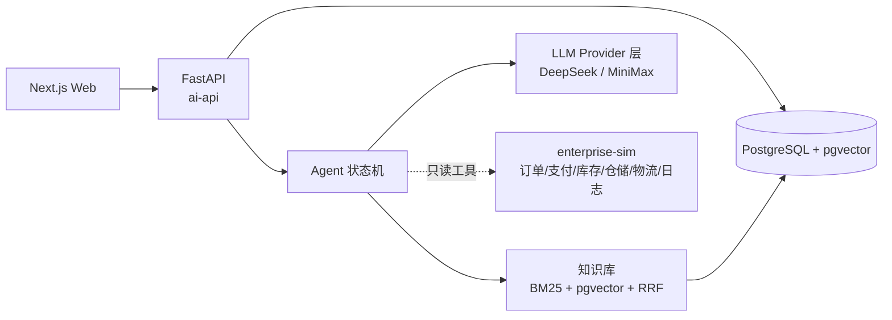

# orderops-agent

> 面向订单履约场景的异常诊断 Agent：多步工具调用 + RAG 领域知识 + 评测驱动的迭代。
>
> A reference implementation of an order-anomaly diagnosis agent: tool-calling state machine, hybrid RAG, and an evaluation harness that drives every change.

一个用合成数据构建的 LLM 应用工程实践项目。所有业务数据、SOP 语料、接口文档均为原创合成，不含任何真实企业数据。

## 它解决什么问题

订单履约链路里，异常排查高度依赖老员工经验：看到"支付成功但订单没动"，要分别去查支付回调、订单事件、MQ 消费日志，再对照 SOP 判断到底是回调超时、幂等冲突还是状态机缺规则。这个项目把这条路径做成一个可复现、可度量、可部署的系统。

## 系统能力

| 能力 | 说明 |
|---|---|
| 多步工具调用 | 8 个只读工具，覆盖订单、支付、库存、仓储、物流、服务日志、SOP 检索、SLA 政策 |
| 显式状态机 | `intake → plan → collect → retrieve → hypothesize → verify → decide → report → wait_human`，带调用预算与降级策略 |
| 领域知识检索 | 应用层 BM25 + pgvector 向量检索，RRF 融合，角色权限过滤，强制引用溯源与拒答 |
| 结构化诊断 | 根因、置信度、证据链、影响范围、处置建议、SOP 引用；后端强校验证据 ID，幻觉引用直接拦截 |
| 评测体系 | 180 条合成故障集 + 自动评测 runner + 失败模式分类 + 双模型对比 |
| 可观测 | 每次运行的节点级 trace、工具耗时、token 与成本核算、响应缓存 |
| 免成本部署 | Docker Compose 本地开发；Vercel Hobby + Neon Free 公网演示 |

## 架构



## 项目状态

本项目以"完整走通 LLM 应用工程链路并留下可验证证据"为目标，按四周推进。当前进度见 [`docs/00-项目状态.md`](docs/00-项目状态.md)。

| 阶段 | 内容 | 状态 |
|---|---|---|
| Week 0 | 架构、数据模型、工具契约、评测与部署方案 | 已完成 |
| Week 1 | 合成数据生成器、模拟企业服务、单次 LLM 基线 | 进行中 |
| Week 2 | 知识库混合检索、Agent 状态机、三类异常打通 | 计划中 |
| Week 3 | 评测集、失败模式分析、双模型对比、可观测性 | 计划中 |
| Week 4 | 公网部署、安全加固、评测报告与作品化 | 计划中 |

## 设计原则

- **证据驱动**：每条根因结论必须引用工具返回的真实证据 ID，后端强校验，引用不存在即判定失败。
- **评测先行**：Week 1 就交付基线与评测 runner；任何提示词、模型、检索参数变更都必须跑回归对比，不允许凭感觉优化。
- **失败可解释**：不只报准确率，还把失败样本打上失败模式标签（选错工具、漏查证据、幻觉引用、过度引用、超时……），由分布表驱动下一步改进。
- **合成数据**：所有数据与语料原创合成并开源可复现，仓库内不含任何真实业务信息。
- **成本有上限**：单次诊断有 token 预算与耗时预算，公网 Demo 有每日全局预算与限流。

## 目录结构

```text
apps/web/              # Next.js 前端
services/ai-api/       # FastAPI：agent / knowledge / llm / eval / observability
services/enterprise-sim/ # 模拟 OMS、支付、库存、WMS、物流、日志的只读服务
packages/shared/       # 跨服务共享的 Pydantic 模型
data/synthetic/        # 合成数据生成器
data/corpus/           # 合成 SOP 与接口文档
docs/                  # 设计文档与评测报告
infra/                 # docker-compose 与部署脚本
```

## 本地运行

需要 Python 3.12（用 [uv](https://docs.astral.sh/uv/) 管理依赖）、Node 24 和 Docker。

```bash
cp .env.example .env
uv sync --all-packages
docker compose up -d --build

curl http://localhost:8000/health    # ai-api
curl http://localhost:8001/health    # enterprise-sim
```

Windows 上首次拉取基础镜像需要走镜像源，见 [`scripts/README.md`](scripts/README.md)。

### 常用命令

| 目的 | 命令 |
|---|---|
| 跑测试 | `uv run --all-packages pytest` |
| 只跑已实现的测试 | `uv run --all-packages pytest services packages/shared` |
| 代码检查 | `uv run ruff check .` |
| 格式化 | `uv run ruff format .` |
| 起容器 | `docker compose up -d --build` |
| 看日志 | `docker compose logs -f ai-api` |

## License

MIT
